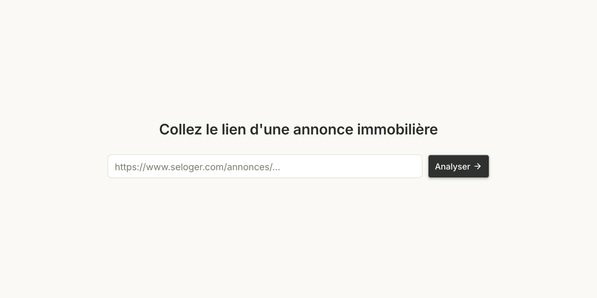
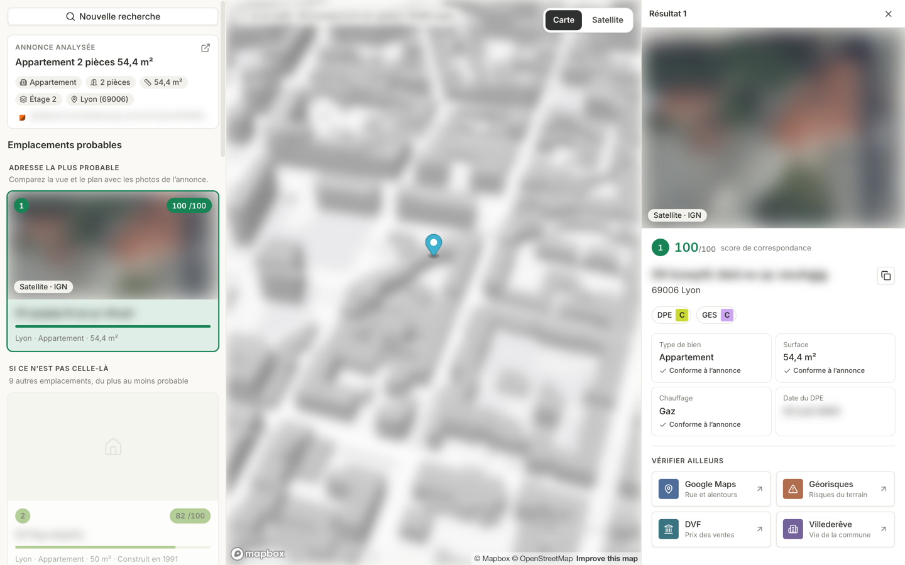

# addressfindr

Paste the link of a French property listing, get back the exact address of the property.

Live: [addressfindr.vercel.app](https://addressfindr.vercel.app)





*Addresses, map, aerial photos and the listing link are blurred in these screenshots: the result is a real home.*

## Why it works

Listing portals hide the address. They show "Lyon 3e", a photo and a price.

But every French listing must show its energy label (DPE), and the state agency ADEME publishes every DPE issued in France as open data, **with the full address**. The listing leaks a fingerprint of itself.

So this is not geolocation. It is record linkage: match the listing's clues to one row of the public register, and read the address off that row.

Measured on the live register:

- Lyon 3e apartments: 35 311 rows.
- Add surface 63 m², DPE D, GES D: still 28 rows. The letter narrows, it never resolves.
- The numeric consumption printed on the label (±5 kWh/m²) cut one 141-row pool to 3.
- The diagnosis date, given in most leboncoin descriptions, matches the register to the day.

## How it works

1. **Ingest** — scrape the listing page (Firecrawl).
2. **Extract** — read structured data first (`__NEXT_DATA__`, JSON-LD). For fields still missing, an LLM returns the *exact quote* where the value appears; the quote is checked against the page, then plain code parses it. The model never produces a value.
3. **Normalise** — commune to INSEE code, surface conventions, French number formats.
4. **Candidates** — query the ADEME registers on commune, type, surface range and DPE.
5. **Score** — rank addresses by the clues that actually tell them apart, or refuse.

**Design rule:** a wrong address costs more than no address. A clue every candidate shares counts as no evidence, and without a discriminating clue the tool says "I don't know".

**Benchmark:** same first address as precisement.fr on 21 of 25 live leboncoin listings.

## Data sources

All public and free: ADEME (DPE registers), geo.api.gouv.fr (communes), BDNB/CSTB (buildings), DGFiP cadastre via IGN, BAN geocoder (IGN). Display: Mapbox, Google Street View, IGN orthophotos.

## Stack

Next.js 16 · React 19 · TypeScript · valibot · neverthrow · Drizzle + Postgres · Groq (`openai/gpt-oss-120b`) · Tailwind v4.

## Run locally

```bash
pnpm install
cp .env.template .env.local   # fill in the keys
pnpm dev
```

Before a PR: `pnpm validate` (types, lint, domain boundaries, tests).

Engineering guide: [CLAUDE.md](CLAUDE.md).
